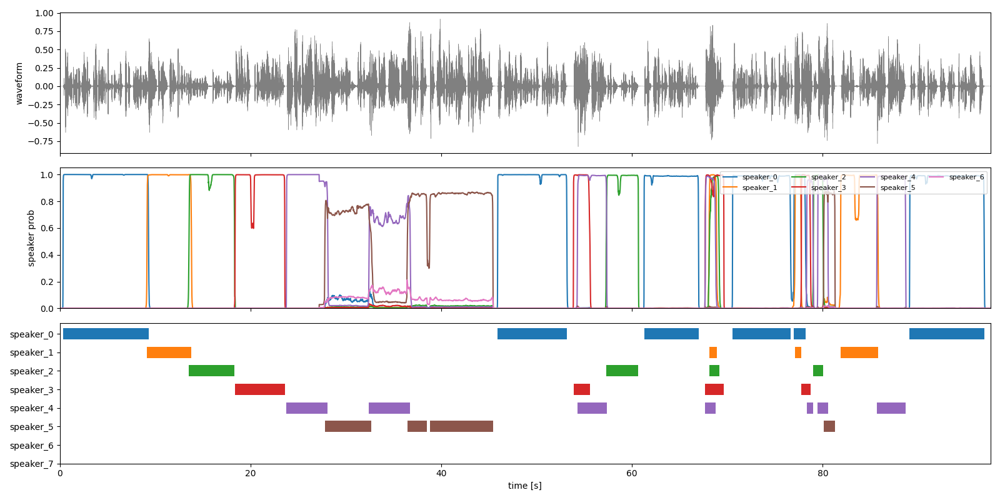

# Nemotron 3 Diarization

## Input

Audio file (`diarization_example.mp3`)

- Conversation of 6 speakers, 16 kHz mono, 97.6 s

(Audio from [hf-internal-testing/dummy-audio-samples](https://huggingface.co/datasets/hf-internal-testing/dummy-audio-samples), the sample audio used in the model card)

## Output

Speech segments of each speaker (up to 8 speakers, numbered in order of arrival)



```
speaker_0: 0.35s - 9.31s
speaker_1: 9.15s - 13.81s
speaker_2: 13.55s - 18.32s
speaker_3: 18.38s - 23.59s
speaker_4: 23.77s - 28.10s
speaker_5: 27.80s - 32.67s
speaker_4: 32.43s - 36.74s
speaker_5: 36.44s - 38.51s
...
```

## Requirements

This model requires additional module.
```
pip3 install librosa
pip3 install pyaudio  # for microphone input mode
```

## Usage
Automatically downloads the onnx and prototxt files on the first run.
It is necessary to be connected to the Internet while downloading.

For the sample audio,
```bash
$ python3 nemotron-3-diarization.py
```

If you want to specify the audio, put the file path after the `--input` option.
You can use `--savepath` option to change the name of the output image to save.
```bash
$ python3 nemotron-3-diarization.py --input AUDIO_PATH --savepath SAVE_IMAGE_PATH
```

The latency can be selected with the `--latency` option. `offline` is used by default.

| latency | input buffer latency | description |
| --- | --- | --- |
| `offline` | 30.4 s | the whole audio is processed in chunks of 27.2 s |
| `low_latency` | 1.04 s | streaming, the audio is fed in chunks of 0.72 s |
| `very_low_latency` | 0.64 s | streaming, the audio is fed in chunks of 0.48 s |
| `ultra_low_latency` | 0.32 s | streaming, the audio is fed in chunks of 0.24 s |

```bash
$ python3 nemotron-3-diarization.py --latency low_latency
```

The speaker probability threshold can be changed with the `-th` option (default is 0.5).

If you specify the `-V` option, it will be in input mode from the microphone (`pyaudio` is required).
The streaming latency is `low_latency`, or the one given by the `--latency` option.

```bash
$ python3 nemotron-3-diarization.py -V
```

1. speak into the microphone when "Please speak something."
2. the speakers of the captured speech are displayed each time a speech section is captured
3. type ``Ctrl+C`` if you want to exit, then the segments of the whole session are displayed and the output image is saved

Only the captured speech sections are fed to the model, so the times are those of the concatenated speech.

The model works on 16 kHz audio. Other sampling rates are resampled to 16 kHz and multi channel audio is mixed down to mono before the inference.

## Reference

- [Nemotron 3 Diarization (Hugging Face)](https://huggingface.co/nvidia/Nemotron-3-Diarization)
- [Transformers Nemotron3Diarization](https://huggingface.co/docs/transformers/en/model_doc/nemotron3_diarization)

## Framework

Pytorch

## Model Format

ONNX opset=17

## Netron

[nemotron-3-diarization.onnx.prototxt](https://netron.app/?url=https://storage.googleapis.com/ailia-models/nemotron-3-diarization/nemotron-3-diarization.onnx.prototxt)
