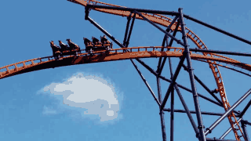
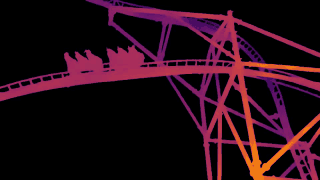

# Video Depth Anything

## Input



(Video from https://github.com/DepthAnything/Video-Depth-Anything/blob/main/assets/example_videos/davis_rollercoaster.mp4)

## Output



## Usage
Automatically downloads the onnx and prototxt files on the first run.
It is necessary to be connected to the Internet while downloading.

For the sample video,
```bash
$ python3 video_depth_anything.py
```

If you want to specify the input video, put the video path after the `--input` option.

You can use `--savepath` option to change the name of the output file to save.
```bash
$ python3 video_depth_anything.py --input VIDEO_PATH --savepath SAVE_VIDEO_PATH
```

By adding the `--metric` option, you can use the metric depth model which estimates the depth in meters.
```bash
$ python3 video_depth_anything.py --metric
```

By adding the `--grayscale` option, you can save the depth video in grayscale.
```bash
$ python3 video_depth_anything.py --grayscale
```

You can use the `--input_size` option to change the input size of the model. (default is 518)
```bash
$ python3 video_depth_anything.py --input_size 518
```

You can use the `--max_res`, `--max_len` and `--target_fps` options to limit the resolution, the number of frames and the frame rate of the input video.
```bash
$ python3 video_depth_anything.py --max_res 1280 --max_len 100 --target_fps 15
```

## Reference

- [Video Depth Anything](https://github.com/DepthAnything/Video-Depth-Anything)

## Framework

Pytorch

## Model Format

ONNX opset=17

## Netron

[video_depth_anything_vits.onnx.prototxt](https://netron.app/?url=https://storage.googleapis.com/ailia-models/video_depth_anything/video_depth_anything_vits.onnx.prototxt)

[metric_video_depth_anything_vits.onnx.prototxt](https://netron.app/?url=https://storage.googleapis.com/ailia-models/video_depth_anything/metric_video_depth_anything_vits.onnx.prototxt)
