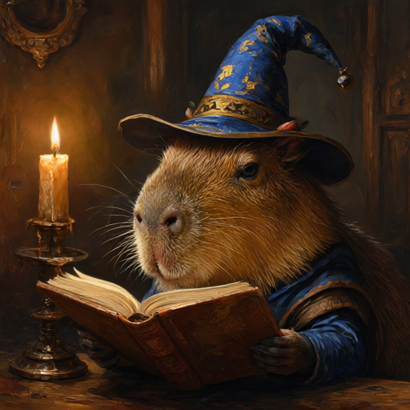
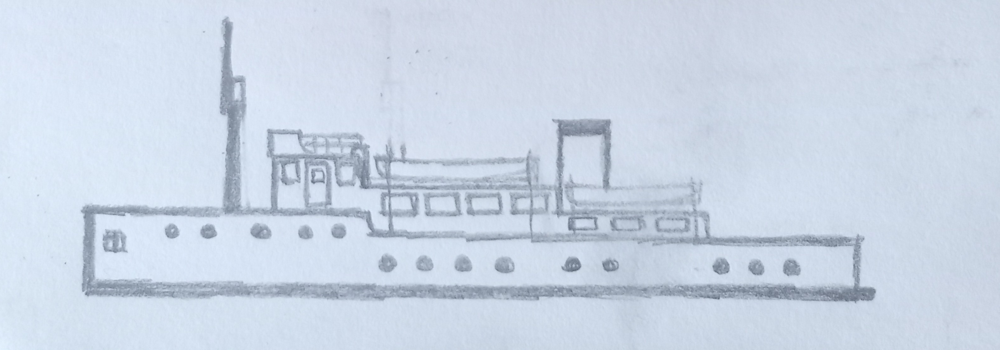
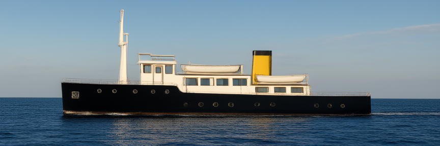

# Qwen-Image-2.1

## Text-to-image

### Input

Prompt:
```
A capybara wearing a wizard hat, reading a book by candlelight, oil painting
```

### Output



(Generated with `--width 512 --height 512 --seed 42`)

## Image editing

### Input

Image:



(Image from https://huggingface.co/Qwen/Qwen-Image-2.1-Turbo/resolve/main/assets/turbo-boat-input.png)

Prompt:
```
Create a photorealistic photograph of the motor yacht from the input sketch, sailing on open sea, captured in full side profile with the camera at water level. Build the vessel with the structure shown in the input sketch: a long low hull; one tall mast stepped forward with a small cross-tree platform near its top; a wheelhouse superstructure with an open bridge wing just behind the mast; a midships deckhouse carrying a row of four rectangular windows with a lifeboat stowed on its roof; a rectangular funnel behind that deckhouse; an aft deckhouse with a row of three rectangular windows and a second lifeboat above it; thin railings along every deck edge; the hull side pierced by one small square window at the bow, an upper line of five round portholes on the raised forward section, and a lower line of nine round portholes along the main hull. Paint the hull black, the superstructures and the mast white, and the funnel yellow. Set the yacht broadside on a calm deep-blue sea with a low gentle swell and a thin white wake trailing from the bow, the straight horizon crossing behind the funnel top, under a clear sky with soft scattered clouds; sunlight from the front left lights the white superstructures and leaves a bright reflection path on the water beside the hull with a soft contact shadow along the waterline; the entire vessel fits inside the frame with open water in the foreground and sky above.
```

### Output



(Generated with `--turbo --output_resolution 512 --seed 43`)

## Usage

Automatically downloads the onnx and prototxt files on the first run.
It is necessary to be connected to the Internet while downloading.

For the sample prompt, (Text-to-image)
```bash
$ python3 qwen_image_21.py
```

If you want to specify the prompt, put the prompt after the `--prompt` option.  
You can use `--savepath` option to change the name of the output file to save.
```bash
$ python3 qwen_image_21.py --prompt PROMPT --savepath SAVE_IMAGE_PATH
```

For image editing, put the image paths after the `--input` option.
Several images can be given as references.
```bash
$ python3 qwen_image_21.py --input IMAGE_PATH --prompt PROMPT
```

The output size is 1024x1024 for text-to-image.
For image editing, it follows the aspect ratio of the last input image, with about `--output_resolution`^2 pixels (default 1024).
The input images are also resized to about `--output_resolution`^2 pixels.
`--width` / `--height` specify the output size directly.
```bash
$ python3 qwen_image_21.py --width 512 --height 512
$ python3 qwen_image_21.py --input IMAGE_PATH --prompt PROMPT --output_resolution 512
```

By adding the `--turbo` option, you can use Qwen-Image-2.1-Turbo, which generates an image in 8 steps.
```bash
$ python3 qwen_image_21.py --turbo
```

### Other options

- `--steps` : number of sampling steps (default 40, ignored with `--turbo`)
- `--seed` : random seed (default: not fixed)

### Memory and speed

The text encoder and the transformer are about 27 GB each in fp32, and are loaded one at a time.
The peak memory usage is about 58 GB, so about 64 GB of RAM is required.

By default, the models run on the CPU.
Measured times on a 16-core CPU are as follows.

| Settings | Time |
|---|---|
| `--turbo --width 512 --height 512` | about 6.5 minutes |
| `--width 512 --height 512` (40 steps) | about 19 minutes |
| default (1024x1024, 40 steps) | about 4.3 hours |

## Reference

- [Qwen-Image-2.1](https://github.com/QwenLM/Qwen-Image-2.1)
- [Hugging Face - Qwen/Qwen-Image-2.1](https://huggingface.co/Qwen/Qwen-Image-2.1)
- [Hugging Face - Qwen/Qwen-Image-2.1-Turbo](https://huggingface.co/Qwen/Qwen-Image-2.1-Turbo)

## Framework

Pytorch

## Model Format

ONNX opset=17

## Netron

[qwen_image_21_vision_encoder.onnx.prototxt](https://netron.app/?url=https://storage.googleapis.com/ailia-models/qwen-image-2.1/qwen_image_21_vision_encoder.onnx.prototxt)  
[qwen_image_21_text_encoder.onnx.prototxt](https://netron.app/?url=https://storage.googleapis.com/ailia-models/qwen-image-2.1/qwen_image_21_text_encoder.onnx.prototxt)  
[qwen_image_21_transformer.onnx.prototxt](https://netron.app/?url=https://storage.googleapis.com/ailia-models/qwen-image-2.1/qwen_image_21_transformer.onnx.prototxt)  
[qwen_image_21_turbo_transformer.onnx.prototxt](https://netron.app/?url=https://storage.googleapis.com/ailia-models/qwen-image-2.1/qwen_image_21_turbo_transformer.onnx.prototxt)  
[qwen_image_21_vae_encoder.onnx.prototxt](https://netron.app/?url=https://storage.googleapis.com/ailia-models/qwen-image-2.1/qwen_image_21_vae_encoder.onnx.prototxt)  
[qwen_image_21_vae_decoder.onnx.prototxt](https://netron.app/?url=https://storage.googleapis.com/ailia-models/qwen-image-2.1/qwen_image_21_vae_decoder.onnx.prototxt)
