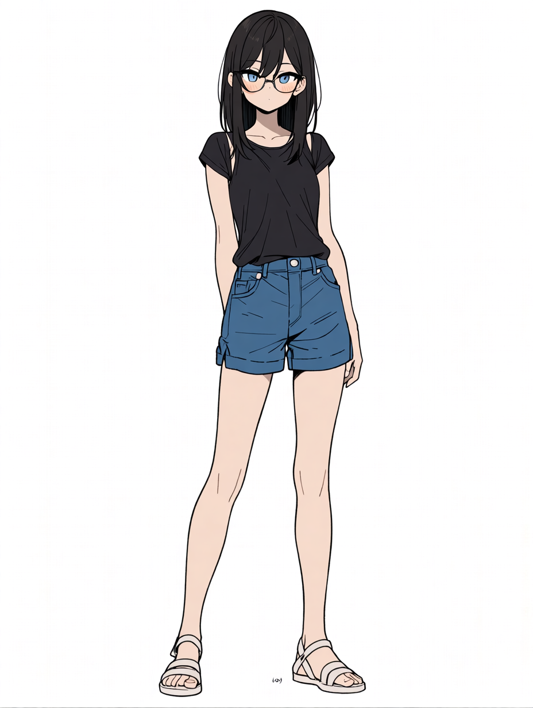
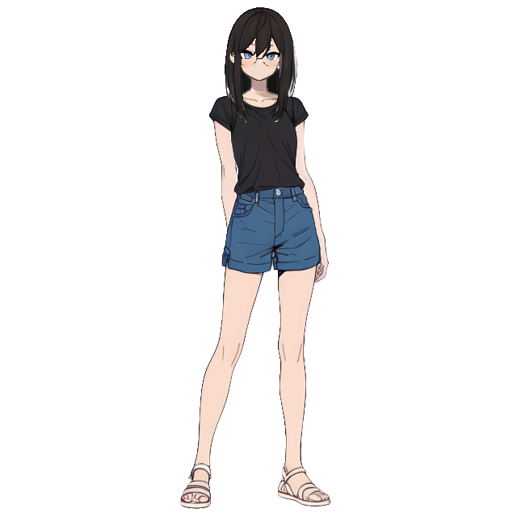
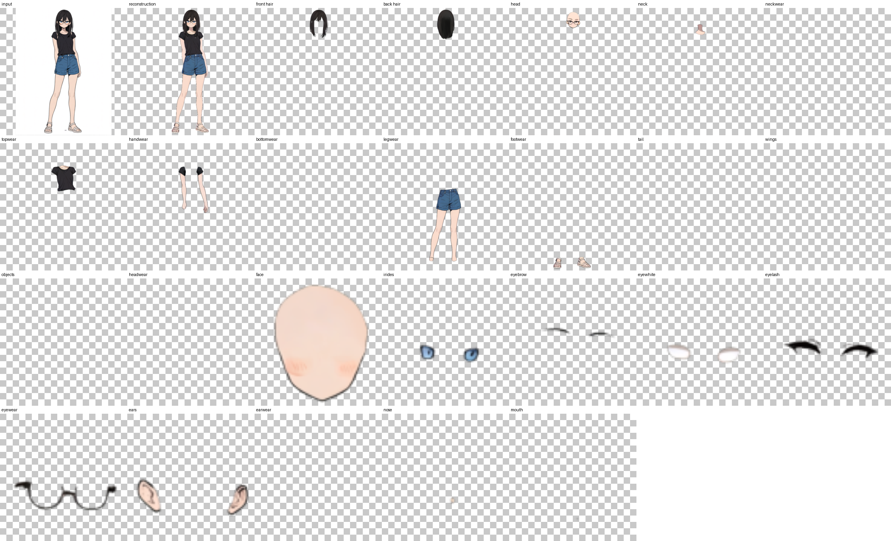

# See-through: Single-image Layer Decomposition for Anime Characters

See-through decomposes a single anime character illustration into semantically distinct,
fully inpainted transparent layers (hair, face, eyes, clothing, accessories, etc.)
and infers their drawing order from estimated depth.

## Input



(Image from https://github.com/shitagaki-lab/see-through/tree/main/common/assets)

## Output

- Layers composited in depth order (`output.png`)

  

- Layer list (`output_layers.png`)

  

The following files are also saved next to the output image.

| File | Contents |
|---|---|
| `output.psd` | Layered PSD file. The layers are stacked in depth order |
| `output_depth.psd` | Depth map of each layer |
| `output.psd.json` | Position and depth of each layer |

## Requirements

This model requires additional module.

```
pip3 install psd-tools
```

## Usage

Automatically downloads the onnx and prototxt files on the first run.
It is necessary to be connected to the Internet while downloading.

For the sample image,
```bash
$ python3 see_through.py
```

If you want to specify the input image, put the image path after the `--input` option.  
You can use `--savepath` option to change the name of the output file to save.
The PSD and JSON files are saved with the same name.
```bash
$ python3 see_through.py --input IMAGE_PATH --savepath SAVE_IMAGE_PATH
```

### Resolution

The default resolution is 640 for the layer decomposition and 512 for the depth estimation,
so that the sample runs on a GPU with 24 GB of memory.

At the default resolution, the decomposition may fail for some images.
For example, part of the background may be mixed into a layer.

For sharper and more accurate layers, specify the resolution used by the original implementation (1280 / 768).
This requires a GPU with more than 24 GB of memory.
```bash
$ python3 see_through.py --resolution 1280 --resolution_depth 768
```

### Other options

- `--steps` : number of sampling steps of the layer decomposition (default 30)
- `--steps_depth` : number of sampling steps of the depth estimation (default 4)
- `--seed` : random seed (default 42)

## Reference

- [See-through](https://github.com/shitagaki-lab/see-through)
- [Hugging Face - layerdifforg/seethroughv0.0.2_layerdiff3d](https://huggingface.co/layerdifforg/seethroughv0.0.2_layerdiff3d)
- [Hugging Face - layerdifforg/seethroughv0.0.1_marigold](https://huggingface.co/layerdifforg/seethroughv0.0.1_marigold)

## Framework

Pytorch

## Model Format

ONNX opset=17

## Netron

[layerdiff_text_encoder.onnx.prototxt](https://netron.app/?url=https://storage.googleapis.com/ailia-models/see-through/layerdiff_text_encoder.onnx.prototxt)  
[layerdiff_text_encoder_2.onnx.prototxt](https://netron.app/?url=https://storage.googleapis.com/ailia-models/see-through/layerdiff_text_encoder_2.onnx.prototxt)  
[layerdiff_vae_encoder.onnx.prototxt](https://netron.app/?url=https://storage.googleapis.com/ailia-models/see-through/layerdiff_vae_encoder.onnx.prototxt)  
[layerdiff_unet.onnx.prototxt](https://netron.app/?url=https://storage.googleapis.com/ailia-models/see-through/layerdiff_unet.onnx.prototxt)  
[layerdiff_vae_decoder.onnx.prototxt](https://netron.app/?url=https://storage.googleapis.com/ailia-models/see-through/layerdiff_vae_decoder.onnx.prototxt)  
[marigold_text_encoder.onnx.prototxt](https://netron.app/?url=https://storage.googleapis.com/ailia-models/see-through/marigold_text_encoder.onnx.prototxt)  
[marigold_vae_encoder.onnx.prototxt](https://netron.app/?url=https://storage.googleapis.com/ailia-models/see-through/marigold_vae_encoder.onnx.prototxt)  
[marigold_unet.onnx.prototxt](https://netron.app/?url=https://storage.googleapis.com/ailia-models/see-through/marigold_unet.onnx.prototxt)  
[marigold_vae_decoder.onnx.prototxt](https://netron.app/?url=https://storage.googleapis.com/ailia-models/see-through/marigold_vae_decoder.onnx.prototxt)
