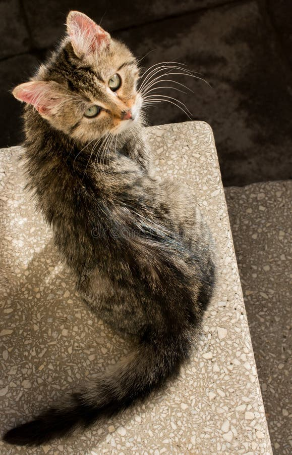

[ailia MODELS](../README.md) > Image quality assessment

# ailia MODELS : Image quality assessment

| | Model | Reference | Exported From | Supported Ailia Version | Date | Blog |
|:-----------|------------:|:------------:|:------------:|:------------:|:------------:|:------------:|
|  | [aesthetic-predictor](./aesthetic-predictor/) | [LAION-Aesthetics_Predictor V1](https://github.com/LAION-AI/aesthetic-predictor) | Pytorch | 1.2.14 and later | May 2022 |  |
|  | [aesthetic-predictor-v2](./aesthetic-predictor-v2/) | [CLIP+MLP Aesthetic Score Predictor](https://github.com/christophschuhmann/improved-aesthetic-predictor) | Pytorch | 1.2.14 and later | November 2026 |  |

[Back to the model list](../README.md)
